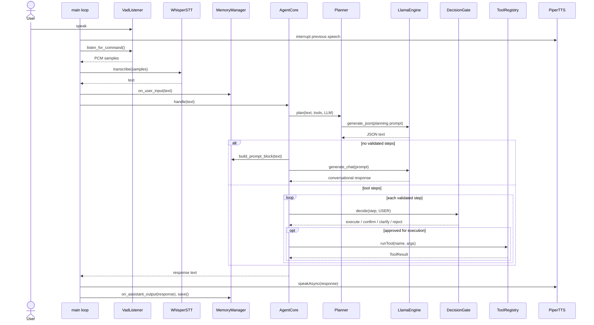

# Request lifecycle

This guide follows one user utterance through the current application. The loop is implemented in [main.cpp](../../core/src/main.cpp), with the agent flow in [agentCore.cpp](../../core/src/agent/agentCore.cpp).

## 1. Capture and transcribe

`VadListener::listen_for_command()` captures mono, 16-bit PCM audio at its configured sample rate using the Windows multimedia input API. It feeds 30 ms frames to WebRTC VAD in aggressive mode. Recording begins when a frame is classified as speech and ends after more than 30 consecutive non-speech frames (about 0.9 seconds).

The resulting sample vector is passed to `WhisperSTT::transcribe()`. The wrapper converts PCM samples to floats, requests greedy English transcription, and concatenates the returned Whisper segments. `main()` then calls `trim_and_normalize()` on the resulting text.

Before transcription, `main()` interrupts current Piper playback. This makes the next input take priority over speech that is still playing.

## 2. Update request memory and handle exit

The text is sent to `MemoryManager::on_user_input()` and printed to the console. The application recognizes `exit`, `quit`, `exit program`, and `stop` as exit commands. That check occurs after the input memory hook, but before agent processing.

For a normal request, `AgentCore::handle()` creates a `Planner` and asks it for a plan using the registered tool descriptions and the shared LLM engine.

## 3. Decide between conversation and action

The planner asks the model for JSON of the form `{"steps":[...]}`. It makes up to three generation attempts. It extracts the first balanced JSON object, parses it, checks that the top-level object contains `steps`, and only retains steps whose tool exists and whose required argument keys pass registry validation.

Argument validation here checks required keys and rejects null values; it does not enforce a general JSON schema or argument types. Unknown tools and invalid steps are skipped rather than reported as a planning error.

If there are no accepted steps, `AgentCore` builds a conversational prompt and calls `LlamaEngine::generate_chat()`. The prompt includes the conversation, selected memory sections, and a Windows-derived world-state block. The LLM response becomes the assistant output.

If there are accepted steps, they are processed sequentially. In the current planner prompt, the model is instructed to produce no steps for ordinary information or casual conversation.

## 4. Gate each action

For each step, the agent invokes `DecisionGate::decide()` with `DecisionSource::USER`. The gate:

1. Confirms the tool exists and checks required arguments again.
2. Maps the tool's declared `ToolRisk` to a low, medium, or high intent risk.
3. Applies a heuristic confidence/ambiguity check to string arguments.
4. Executes safe actions, requests confirmation for configured higher-risk actions, asks for clarification when inputs are ambiguous, or rejects a high-risk action below its confidence threshold.

The built-in shutdown tool declares `CRITICAL` risk and therefore requires confirmation when its arguments pass the gate. Confirmation is currently read from `std::cin` and must be exactly `yes`; it is not a spoken confirmation flow. See [Components and extension points](./components-and-extension-points.md#decision-gate-and-execution) for risk behavior.

The gate receives the full user input, but the current implementation does not use it to assess intent. Its confidence score is derived from tool risk and argument values.

## 5. Execute and react to failures

`Executor::executeStep()` dispatches through `ToolRegistry::runTool()`. If execution succeeds, its output is appended to the reply. If it fails, `Reflector` interprets the tool's output text:

- An output containing `not found` for `open_app` creates a fallback `open_website` step using a normalized application name as a `.com` domain.
- Other `not found` errors ask the user what should be opened.
- An output containing `missing` asks the user for more details.
- An output containing `cancelled` requests one retry.
- Other failures abort with the tool's error output.

Retry and fallback steps are sent directly to the executor. They do not pass through the decision gate again. If a plan has multiple steps, processing stops on the first clarification, rejection, or failure response; successful step outputs are collected in a string.

The tool branch returns tool output text. It does not make a separate LLM call to turn those results into a natural-language summary.

## 6. Speak and persist

After agent processing, `main()` prints the assistant output, calls `PiperTTS::speakAsync()`, records the assistant output in conversation memory, and calls `MemoryManager::save()`. The speech call runs generation/playback asynchronously, while the main loop continues to its next audio capture. On the next utterance, `piper.interrupt()` joins and stops outstanding speech work.

Conversation summaries may be generated at the memory manager's eight-assistant-output interval. See [Memory and persistence](./memory-and-persistence.md).

## Sequence diagram

The diagram omits failure reflection branches and background services; those are described above and in [Background work](./background-work.md).
