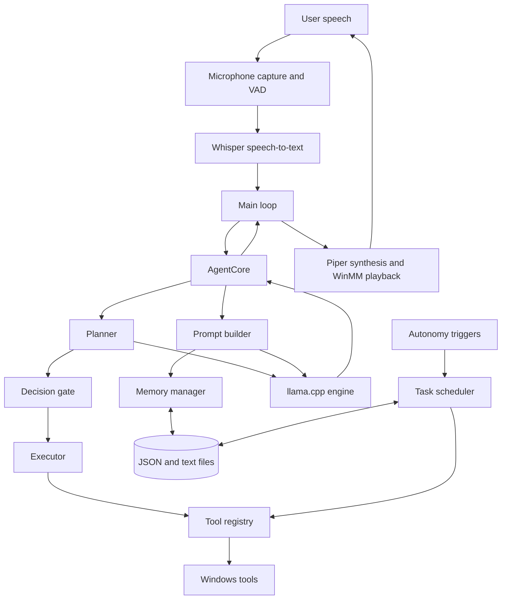

# System overview

## What Atlas is

Atlas AI is a local, voice-first assistant implemented as a C++17 Windows executable. It connects local speech recognition and synthesis to a local language model, then provides a small set of Windows-oriented tools and file-backed memory. There is no separate web service, database server, or UI process in the current application.

The main executable owns the system's long-lived objects and coordinates the request loop. The principal runtime entry point is [main](../../core/src/main.cpp).

## High-level architecture

The diagram is conceptual. For example, the scheduler is initialized with the tool manager and registry, while the autonomy service only submits tasks to the scheduler. Background tool tasks currently go directly to registry dispatch rather than through `AgentCore` or the decision gate.

## Process composition

`main()` constructs one `LlamaEngine`, one `WhisperSTT`, one `PiperTTS`, a `ToolRegistry`, a `ToolManager`, a `TaskScheduler`, a `MemoryManager`, and an `AutonomousSystem`.

Startup proceeds in this order:

1. Load the LLM and speech-recognition models.
2. Construct and start the scheduler.
3. Register the built-in tools.
4. Construct and load memory.
5. Start autonomy triggers.
6. Enter the continuous voice-input loop.

Each recognized request gets a new `agent::AgentCore`; its planner, executor, reflector, and decision gate are also short-lived objects created while handling that request. The model, tools, memory, scheduler, and speech services are shared across requests.

On normal loop exit, `main()` stops autonomy first and then stops the scheduler. Model and audio objects are released through their destructors. There is no general exception boundary around startup or the main loop, so model initialization errors can terminate startup.

## Architectural boundaries

### Application orchestration

`main.cpp` wires services together and owns the main input/output lifecycle. It is also responsible for asking VAD for audio, interrupting previous speech, invoking transcription, normalizing the resulting text, calling memory hooks, dispatching to the agent, and speaking the returned text.

### Agent pipeline

The `agent` namespace makes a plan and processes its steps. A plan with no accepted tool steps is treated as a conversational request. A plan with steps is sent through a decision gate and executor; failed executions may be retried, replaced by a fallback, or returned as a clarification/failure.

### Model and prompts

`LlamaEngine` wraps llama.cpp and exposes separate generation methods for free-form chat and constrained-looking JSON output (implemented by greedy token generation and brace tracking). Prompt construction is separate: conversational prompts include world state, memory, and the current user message. The planner builds its own tool-oriented prompt.

### External actions

`Tool` is the extension interface. `ToolRegistry` owns tool instances and exposes descriptions, required-argument checks, risk levels, and dispatch. `ToolManager` registers the built-ins. Current actions launch configured Windows applications, open URLs, schedule reminders, and request a system shutdown.

### Speech

Input is captured as mono 16-bit PCM through WinMM. WebRTC VAD decides when speech begins and when a silence interval ends. Whisper converts the buffered samples to English text. Piper is invoked as a separate executable to generate a WAV file, and WinMM plays that file asynchronously.

### Memory and background tasks

Memory is a collection of text/JSON-backed stores rather than a database. The scheduler checks due timestamps in a worker thread. Autonomy polls Windows idle and battery state and submits generated tasks to that scheduler. Their data flows and current constraints are described in [Memory and persistence](./memory-and-persistence.md) and [Background work](./background-work.md).

## Design characteristics

- **Local-first inference:** the LLM, Whisper model, and Piper voice are loaded or run locally; model files are supplied separately from source.
- **Single-process composition:** model, memory, and service objects are assembled directly in `main()` rather than behind a dependency-injection framework.
- **Synchronous request path:** the main loop processes one user request at a time. Speech generation and playback are asynchronous, but the main voice loop waits for the next utterance.
- **Explicit tool allowlist:** only registered tools can be planned and dispatched through `ToolRegistry`.
- **File-backed state:** small JSON and text files keep memory, app paths, and scheduled tasks. There is no schema migration layer.
- **Windows-specific integration:** WinMM, ShellExecute, Windows power/idle APIs, and command-line execution are part of the current design.

## Important implementation caveats

- An empty plan means “answer conversationally.” The planner also returns an empty plan when it cannot produce or parse an acceptable plan after its retries, so a planning failure can be indistinguishable from an intentional chat plan.
- User-request tool calls use the decision gate. Scheduled task calls do not currently use that gate, and scheduler dispatch ignores the returned tool result.
- Autonomy is experimental. Its generated `speak` and `enable_battery_saver` calls are not among the registered tools.
- Paths used for model files, app configuration, and Piper scratch files are relative to the process working directory and are not resolved from the executable location.
- See the focused guides for additional component-specific limitations.

## Further reading

- [Request lifecycle](./request-lifecycle.md)
- [Components and extension points](./components-and-extension-points.md)
- [Memory and persistence](./memory-and-persistence.md)
- [Background work](./background-work.md)
- [Build and runtime](./build-and-runtime.md)